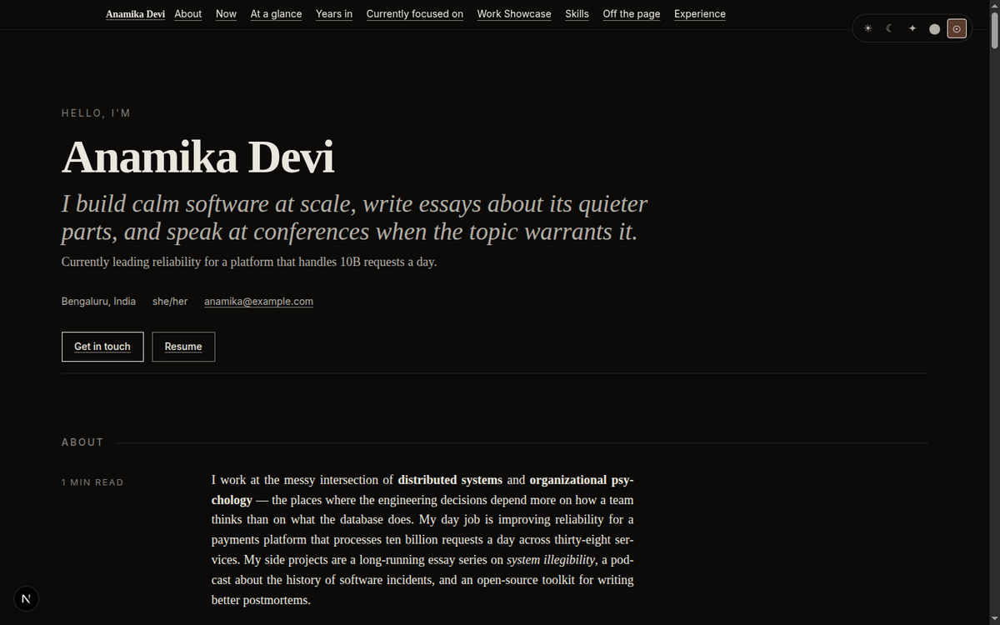
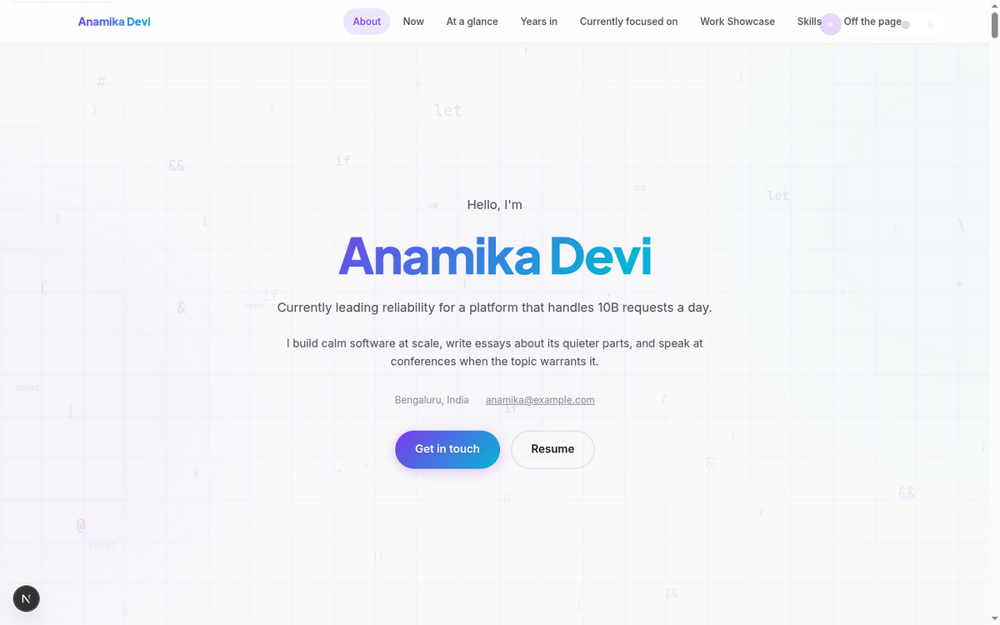

# Portfolio Platform

An open-source, self-hostable portfolio platform with pluggable variants.

You write two documents. `portfolio.yml` says who you are and what you've done, and `site.yml` says how the site presents it: the variant, color scheme, typography, display mode, motion, and which sections show. The platform validates them as a pair and renders the portfolio through the site's variant, a composition package that decides how the sections are arranged, navigated, and revealed; color, type, and display modes belong to the appearance system (#19). Changing `site.yml` changes the presentation without touching content, and editing `portfolio.yml` changes content without touching code. Deployment settings and secrets stay in the environment.

```
portfolio.yml + site.yml ── @portfolio/schema ── apps/web ── a variant package ── browser
                             (validate)           (host)       (compose)
```

Designed for engineers, makers, photographers, writers, musicians, designers, consultants, and academics who want to own their portfolio without learning a templating engine. The content model doesn't assume a profession, and a profession package can add its own fields and sections.

**Live demo:** the demo deployment (self-hosted, see [docs](docs/deployment.md#demo)).

<p align="center">
  
  
</p>

<p align="center"><em>The same <code>portfolio.yml</code> rendered through the v1 variants, Editorial and Kinetic Cosmos, which #13 and #14 rebuilt as the compositions Editorial Evidence and Kinetic Cosmos.</em><br/>
<strong><a href="SHOWCASE.md">See the full visual showcase »</a></strong></p>

## Quick start

```sh
pnpm install
pnpm dev
```

Visit `http://127.0.0.1:3000`. With neither document in `config/` yet, it renders the bundled examples. Copy `portfolio.example.yml` to `config/portfolio.yml` and `site.example.yml` to `config/site.yml`, and edit them; the page picks up each save.

To run in Docker (production), with both documents in `config/` and `PORTFOLIO_ORIGIN` set in `.env`:

```sh
docker compose up --build
```

That runs the `read-only` profile, which serves `config/` as it is. Under the `owner` profile (`deploy/compose.owner.yml`), the first start imports the mounted files, and from then on they're import input: an edit goes live only through `portfolio-store import` or a Studio publish ([docs/deployment.md](docs/deployment.md#the-revision-store)).

See [docs/getting-started.md](docs/getting-started.md) for the full walkthrough.

## What's in the box

- **28 section kinds**: hero, lede, experience, projects, skills, GitHub, gallery, discography, episodes, testimonials, publications, talks, awards, and more. See [docs/features.md](docs/features.md).
- **Content extensions**: namespaced fields and section kinds from a profession package, checked when the build registers it and kept out of visitors' view when it doesn't.
- **Variants as compositions**: each is a package, installed as a dependency and registered at build time. A variant arranges the content through the kit's shared section renderers or its own; when the site's variant isn't installed, the fallback composition renders in its place and the owner gets a warning. Building one: [docs/variants.md](docs/variants.md).
- **Appearance in the site document**: the variant, and the design language, color scheme, typography, and display mode that #19 (appearance axes) resolves. Every page renders in them from the server, and visitors change the `selectable` ones in the Appearance control.
- **Validation that says where**: every problem in either document comes with its code, file, line and column, and fix, from `pnpm config:validate` or the server at startup. A missing, doubled, or unreadable document is about the file, so its record has no line or column.
- **GitHub sections** link the profile; repository data reaches variants through the render input with #10. Public pages never send a token.
- **Feed, structured data, canonical links, and a generated share image**, each rendered per request from the live revision on the deployment's one origin.
- **Drift gates** keep the schema, kit catalog, and skill references in sync (`pnpm check:skills`).
- **AI-assisted authoring and variant development** via two skills under [skills/](skills/).

## Workspace layout

```
apps/
  web/                          Next.js host (routes, data loading, SEO)

packages/
  schema/                       The portfolio and site schemas, validation,
                                extensions, and the one-time migration
  variant-contract/             The variant contract: manifest, render input,
                                controls, routes, registry, audit
  kit/                          Shared utilities (section renderers, enhancements,
                                motion, format helpers, SEO, spatial primitives)
  core/                         Server-only owner code
  fallback-composition/         The stand-in composition, and the scaffold for new ones
  variant-editorial-evidence/   Editorial Evidence, the platform default composition
  variant-kinetic-cosmos/       Kinetic Cosmos, a composition a site can select
  variant-obsidian-atelier/     Obsidian Atelier, a composition a site can select
  variant-spatial-bento/        Spatial Bento, a composition a site can select

docs/
  architecture.md               How the pieces fit
  getting-started.md            Install, run, edit
  configuration.md              Both documents, field by field
  authoring.md                  Writing a good portfolio
  variants.md                   Building a variant
  appearance.md                 The appearance contract and pack format
  deployment.md                 Production deployment
  features.md                   Feature catalog

skills/                         AI agent skills
                                (portfolio-author, variant-developer)

config/                         Your portfolio.yml and site.yml (gitignored)
portfolio.example.yml           Fully populated example portfolio
site.example.yml                Example site document
```

## Documentation

| For                                | Read                                                   |
| ---------------------------------- | ------------------------------------------------------ |
| First-time visitors                | [docs/getting-started.md](docs/getting-started.md)     |
| Authors writing the documents      | [docs/authoring.md](docs/authoring.md)                 |
| Every field and diagnostic code    | [docs/configuration.md](docs/configuration.md)         |
| Developers building variants       | [docs/variants.md](docs/variants.md)                   |
| Developers building packs          | [docs/appearance.md](docs/appearance.md)               |
| Architects understanding internals | [docs/architecture.md](docs/architecture.md)           |
| Operators deploying to production  | [docs/deployment.md](docs/deployment.md)               |
| Reviewers checking security        | [docs/threat-model.md](docs/threat-model.md)           |
| Looking for a feature              | [docs/features.md](docs/features.md)                   |
| AI agents authoring portfolios     | [skills/portfolio-author/](skills/portfolio-author/)   |
| AI agents building variants        | [skills/variant-developer/](skills/variant-developer/) |

## Contributing

See [CONTRIBUTING.md](CONTRIBUTING.md) for development setup, coding conventions, and the [checks](CONTRIBUTING.md#checks) that must stay green.

## License

[MIT](LICENSE).
