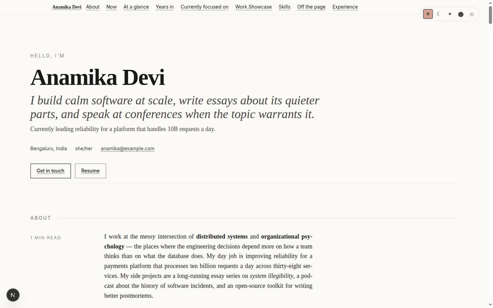
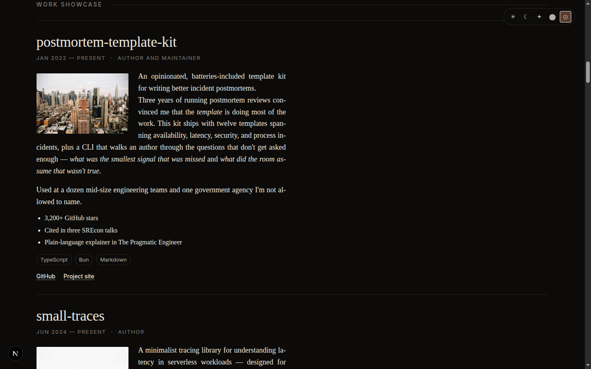
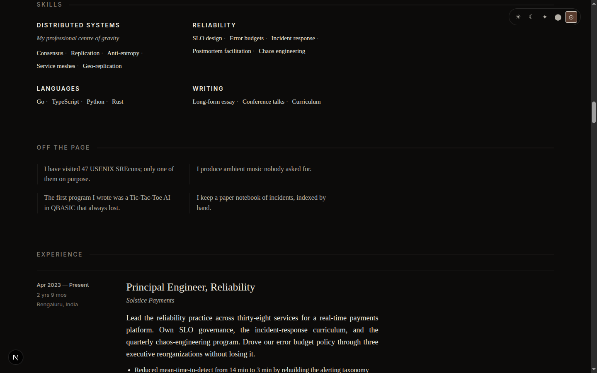
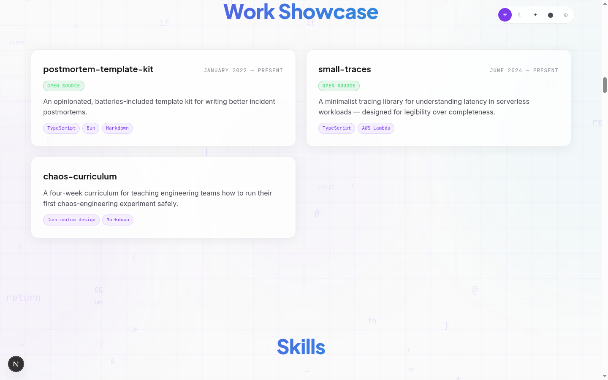

# Portfolio Platform: Visual Showcase

A tour of the portfolio platform. You write two documents, `portfolio.yml` for the content and `site.yml` for how it's presented, and the platform validates them as a pair and renders the portfolio through the site's **variant**: a styled React tree that owns layout, color, typography, and motion. Switching variants changes the look without touching content.

> _Screenshots use the bundled `portfolio.example.yml` demo persona ("Anamika Devi"). All content is illustrative._

---

## Editorial variant

A premium, print-quality typographic variant, accessible and navigable, with a serif voice.

### Hero (dark)

### Hero (light)

The same page in the `light` theme, one of the five themes the visitor toggle offers (`light`, `dark`, `bright`, `black`, `system`).

### Work Showcase

Project cards with imagery, rich descriptions, tech tags, and links.

### Skills

---

## Kinetic Cosmos variant

The **same content** in a completely different aesthetic: a gradient nebula, falling code-glyph particles, and a branching career timeline.

### Hero

### Projects

---

## At a Glance

| Capability        | Detail                                                                                                                                  |
| ----------------- | --------------------------------------------------------------------------------------------------------------------------------------- |
| **Content model** | `portfolio.yml` for the content and `site.yml` for the presentation, validated as a pair against `@portfolio/schema`                    |
| **Section kinds** | 28 profession-neutral kinds, such as hero, experience, projects, gallery, discography, episodes, and publications, plus extension kinds |
| **Appearance**    | Variant, design language, color scheme, and typography as independent axes, plus the display mode                                       |
| **Variants**      | Pluggable styled React trees; swap the entire look without touching content                                                             |
| **Themes**        | `light`, `dark`, `bright` (paper-white), `black` (AMOLED), `system`                                                                     |
| **Per-variant**   | Color schemes and typography presets (Editorial ships 3 schemes, 2 type pairings)                                                       |
| **GitHub**        | Top repos, recent activity, language breakdown, from GitHub's public REST API                                                           |
| **Extras**        | Print stylesheet, feed, structured data, Open Graph image generation                                                                    |
| **Editing**       | Edit the documents in `config/`; the server validates them at startup                                                                   |
| **Stack**         | Next.js, TypeScript, pnpm workspace, Docker                                                                                             |

---

_See the [README](README.md) for setup, variant authoring, and the full feature list._
